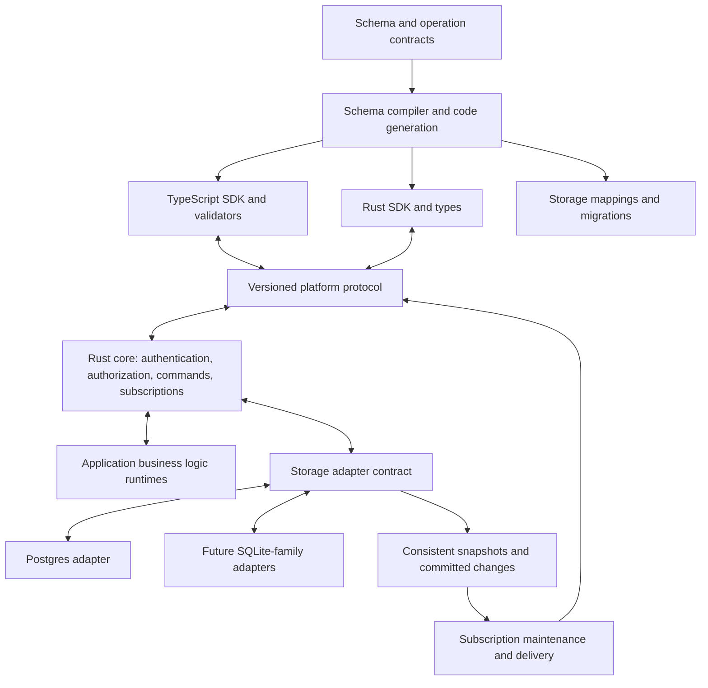

# Hulla DB — architecture and implementation design

**Status:** Architecture proposal; schema/value/projection contracts, JSON codec, benchmarks, an authoritative PostgreSQL command/query backend and bounded CDC capture/snapshot/replica implemented; CDC is the sole PostgreSQL sync model; general storage enforcement, authorized CDC query serving, and configurable concurrency remain future work

**Updated:** 5 October 2026

**Audience:** Product owner, future implementation agents, and contributors

## 1. Product direction

Package naming: `@hulla/db` for npm and `hulladb` for the Rust SDK. Supporting
Rust crates use the `hulladb_` prefix, such as `hulladb_schema`.

Build a self-hostable reactive database platform with a Rust core, PostgreSQL as its first authoritative storage backend, and first-class Rust and TypeScript SDKs.

Applications should feel immediate because they query synchronized local data and can optionally apply optimistic writes. The server determines which writes commit and which data each client may receive. Disconnected mutation authoring and later conflict merging are outside the initial product contract.

The intended developer experience combines Zero-style local querying and synchronization with Convex-style integrated schemas, typed operations, and reactive subscriptions. Storage adapters must allow SQLite and related engines to be added without redesigning the protocol, subscription engine, or SDK APIs.

This is initially a database platform built around an existing storage engine. Building a new on-disk storage engine is not required to deliver the product.

## 2. Requirements and decision status

### Confirmed requirements

- Rust implementation for the platform core.
- First-class Rust and TypeScript/JavaScript SDKs.
- PostgreSQL as the initial default server database.
- Architectural boundaries that accommodate SQLite, libSQL, and Turso Database adapters later.
- End-to-end type safety between declared tables, operations, and SDK usage.
- `id` is optional in a table declaration; omitting it adds a UUID field with
  UUID generation using the schema-wide v4/v7 default (v7 when unconfigured).
  The primary key defaults to `id`, whether implicit
  or explicitly declared with an overridden type. Developers can explicitly
  select another primary key and override generation logic independently.
- Selecting another primary key suppresses implicit `id` injection; explicitly
  declared fields are preserved.
- The initial logical contract supports single-field UUID, string, and signed
  64-bit integer primary keys. Boolean keys are rejected; composite primary keys
  require later tuple/reference support. Multi-field business uniqueness remains
  a separate constraint requirement and is not satisfied by a generated row ID.
- Tables can declare named single-field or multi-field unique constraints.
  Nullable unique fields require an explicit null comparison policy. Structural
  normalization is implemented; storage must enforce these constraints atomically
  under concurrent inserts/updates and validate existing data during activation.
- Each table can allow caller-supplied insert keys or require automatic generation.
- UUID primary keys inherit a configurable schema-wide UUIDv4 or UUIDv7 default,
  with UUIDv7 when unconfigured. Explicit table-level generator settings take
  precedence, including disabled generation and custom handlers. String and integer keys require
  caller-supplied values unless a compatible generator is configured. Inserts
  accept explicit keys by default and generate omitted keys when possible.
- The selected primary key is immutable in ordinary updates. Updates cannot
  supply that field, even with its current value. Any future key-change operation
  must explicitly define relationship and synchronization behavior.
- Schema fields use declarative validator descriptors, and relationships are
  explicitly defined by the application developer.
- References require referential integrity. Non-null references must target
  existing authoritative rows, and referenced-row deletion is restricted in the
  initial contract. Automatic cascade/set-null behavior requires an explicit
  later contract; the initial slice has no dangling-reference opt-out.
- Authoritative writes must preserve ACID. Reference enforcement must be atomic
  with the write and remain correct under concurrent commands. Schema or client
  validation does not replace storage constraints and transaction isolation.
- A live development workflow that watches schema changes and regenerates runtime schemas, both SDKs' types, and migration plans, while keeping data transformations explicit.
- Server-authoritative transactions, permissions, and business rules.
- Application-defined concurrency behavior, with safe built-in defaults and
  operation-level policies for specialized workloads. Collaboration must use
  the same authoritative mutation and sync foundations as single-client use.
- Reactive local reads over an authorized subset of server data.
- Both optimistic local-plus-server writes and server-confirmed writes, selectable by the application developer.
- Optimistic changes reconcile to server results and roll back on definitive rejection.
- No requirement to accept new writes while disconnected.
- Free self-hosting, with a possible paid managed hosting offering.
- Client data exposure must be controlled on the server.
- A lean production package and low runtime overhead. End-user query/write
  responsiveness and client/server latency take priority over build/compile speed.
- Public API syntax remains provisional.

### Recommendations requiring eventual product approval

The choices below guide this proposal but are not previously agreed requirements:

1. Native schema authoring in Rust or TypeScript, compiled into one language-neutral internal contract that drives both SDKs and storage definitions. Each project chooses one authoritative authoring source.
2. Query-driven synchronization, with explicit preloading of bounded datasets.
3. Separate confirmed client data and optimistic layers.
4. Platform mutations use managed transactions. External writers may be observed
   through CDC once its correctness is proven; their business rules remain the
   responsibility of the application and database constraints.
5. PostgreSQL CDC feeding committed sync events and separate bounded sync storage.
   This is the selected sole PostgreSQL synchronization model. Commands write
   authoritative rows and receipts; they do not emit a separate delivery feed.
6. A constrained portable query model, with explicit backend-specific extensions.
7. In-memory client querying first; persistence behind a separate adapter.
8. Server-confirmed writes as the safe initial default, overridable per operation and call.
9. One authoritative write region per deployment initially.

An implementation agent must preserve confirmed requirements, identify changes to these recommendations, and avoid treating illustrative API spelling as a specification.

### Runtime priorities and production consolidation

User priority, confirmed on 5 October 2026: applications should feel immediate;
runtime responsiveness and client/server latency matter more than short builds.
Move reproducible schema/query preparation into compilation where appropriate,
while retaining authoritative runtime authorization, input validation, and database
constraints. A longer build is acceptable when it reduces shipped code or runtime
work without changing query semantics.

Decision, confirmed on 5 October 2026: use one PostgreSQL synchronization path:
committed WAL → Rust CDC capture → bounded durable event history → durable replica
→ authorized query results → SDKs. The command-written task feed, RAM replica,
comparison harness, demo and obsolete baselines are removed. Keep authorization,
version checks, atomic receipts and bounded queries in the authoritative backend.
A generation-two internal schema upgrade preserves tasks and receipts and removes
the old source delivery table. A command receipt is an acknowledgement and query
freshness token, never a second sync event.

Keep privileged PostgreSQL capture and server sync storage out of SDK dependencies.
Use one shared Rust query/replica core, native for Rust and through a Wasm binding
for TypeScript, with thin TypeScript UI integration. Storage adapters may vary by
platform. Measure bundle size, startup, worker scheduling and batched interop before
shipping; sharing Rust semantics does not establish a latency advantage over TS.
Do not ship independent Rust and TS query engines by default.

Separate interactive latency from synchronization work:

| Metric | Intended behavior and measurement |
| --- | --- |
| Covered local query to rendered UI | Read confirmed cached data without a network round trip; measure query execution plus rendering, allocations, and payload size. |
| Cold query to usable result | Return a bounded authorized result promptly; measure realistic RTT, server work, transfer/decoding, and initial client application. |
| Write submission to durable acknowledgement | Authorize, validate, commit PostgreSQL rows and the request receipt, then return the committed result. Do not normally wait for CDC log/replica persistence or subscriber fan-out. |
| Commit to subscription visibility | Deliver authorized committed changes promptly through the sync path; measure queueing, capture, materialization, fan-out, and client application separately. |

Committed and visible are distinct statuses. Preserve receipt recovery for ambiguous
outcomes and correlate committed operation results with sync delivery. An explicit
read-after-write request may need to wait for a visibility fence or read authoritative
state. A fast acknowledgement must not label a lagging replica current. Optimistic
UI remains optional per operation; retain prediction/reconciliation state until its
committed effects are represented rather than introducing a visual reversal while
subscriptions catch up.

The [current benchmark suites](benchmarks.md) measure command acknowledgement,
commit-to-replica lag, durable materialization and bounded queries separately.
They use the actual command table, with no shadow/mirror table. Local streaming
and internal row views do not measure client/server RTT, authorized subscriptions,
browser rendering or production tails. Use p50/p95/p99 under representative RTT,
concurrency, result sizes and subscriber counts as those layers are implemented.

Capture now uses a persistent replication connection; the SQL peek/advance path
has been removed. Bootstrap now creates a dedicated slot through a bounded
replication command connection and imports its exported snapshot. The overlapping
bootstrap and its XID epoch restriction are removed. Recovery, external writes,
TRUNCATE locking and cancellation scenarios verify the handoff; retain the stated
schema/publication and resource limits. Local streaming measurements do not
establish a client/server or browser latency improvement.

## 3. Lessons from comparable systems

This comparison is based on the linked architecture documentation, not an implementation audit or performance benchmark. Product details can change; recheck relevant sources before adopting dependencies.

| System | Relevant architecture | Lesson for this platform |
| --- | --- | --- |
| Zero | Queries synchronize a partial client replica. Available local results are returned before server hydration; mutations can run optimistically and reconcile. | Query-driven loading, local query evaluation, and typed named operations. Keep the server's authorized query definition authoritative. |
| Convex | Server functions query a reactive database; clients subscribe to function results. | Integrated schema and operation tooling. Arbitrary server functions should remain server-executed rather than being assumed locally reproducible. |
| PowerSync | Source changes become reusable sync buckets and client SQLite data. Checkpoints establish consistent local state; local writes can use an upload queue. | Checkpointed publication, reusable sync work, and separation between source connectors and delivery. Its offline upload queue is unnecessary for our initial contract. |
| Electric Sync | Read-path synchronization through shapes; application writes use a separate backend. Shapes support row/column scoping and progressive loading. | Separate authoritative commands from replica maintenance. Make synchronization scope explicit and enforce it server-side. |
| InstantDB | A Postgres-backed triple store, local query evaluation, pending optimistic changes, and dependency-based server invalidation. | Query-aware client state and separate speculative layers. A triple-store persistence model is an alternative, not a requirement. |
| LiveStore | Ordered events are synchronized and materialized into local SQLite; pending events are rebased. | Reactive projections, ordered delivery, and atomic publication. Whole-application event sourcing and client event rebasing are unnecessary for the proposed contract. |

Electric Circuits is an additional source-review candidate: its repository describes a Rust engine that consumes Postgres logical replication and maintains live query results incrementally. Investigate its design before investing heavily in our own incremental query execution. Do not assume its maturity or benchmark results apply to this platform.

Sources are collected in section 17.

## 4. System boundaries



These are module boundaries, not a requirement to deploy each box as a service. Start with a modular Rust service; isolate application JavaScript execution where needed. Split services only for demonstrated operational or scaling needs.

### Recommended module responsibilities

| Module | Owns | Must not depend on |
| --- | --- | --- |
| Schema/compiler | Logical types, projections, operation contracts, generated artifacts | A particular client's UI framework |
| Query model | Typed query representation, portable semantics, capability checks | Raw backend SQL as the public contract |
| Storage adapter | Query compilation, transactions, constraints, mappings, migrations | Browser state or UI subscriptions |
| Change source | Snapshot boundary, ordered committed batches, resume/reset behavior | Client presentation choices |
| Reactive core | Membership, dependency tracking, authorized projections, result changes | Postgres LSN formats or SQLite internals |
| Protocol | Versioned messages, typed values, errors, request IDs, cursors | SDK implementation language |
| SDK replica | Coverage, confirmed records, speculative layers, subscriptions | Database credentials or privileged application code |
| Business logic runtime | Execution of application-defined operations through a constrained API | Unrestricted access to another tenant's resources |
| Cloud control plane | Provisioning, billing, backups, operational management | Mandatory participation in self-hosted deployments |

## 5. Type safety from tables to SDKs

The incremental [schema contract discussion](schema-contract.md) records accepted
decisions, implemented contracts, and remaining questions. The separate
[wire format](wire-format.md) describes the implemented lossless JSON record codec.

### Recommended source of truth

Let developers author the schema in Rust or TypeScript, using each language's native tooling. Compile the chosen source into one declarative, language-neutral internal contract describing:

- Tables, fields, logical types, nullability, identifiers, relationships, indexes, and constraints.
- Explicit client-visible projections and their access policies.
- Named queries and commands, including input/output types and structured errors.
- Schema versions and supported backend capabilities.

The exact syntax is open: a TypeScript builder API and Rust derive/attribute macros with explicit schema registration are candidates. The canonical intermediate representation is a generated compiler artifact, not a file developers must ordinarily author by hand. A neutral-file import/export path can exist for tools.

A project selects one authoritative schema entry point, in either language. A TypeScript-authored schema can generate a Rust SDK, and a Rust-authored schema can generate a TypeScript SDK. Developers must not maintain two independent definitions of the same tables. Support changing the authoring language only through an explicit transition that preserves stable schema identities and verifies equivalent contracts.

The compiler produces backend DDL/migration plans, runtime validators, Rust models/query builders, TypeScript types/query builders, and operation descriptors. Command contracts should reference schema types instead of duplicating table field definitions.

Type safety is layered:

1. **Compile time:** invalid fields, mismatched identifiers, wrong argument types, and invalid projections fail in Rust or TypeScript.
2. **Runtime boundary:** validate every network request, response, and decoded persisted value. JavaScript callers and malicious clients do not obey static types.
3. **Database:** enforce applicable foreign keys, uniqueness, nullability, and check constraints in storage.
4. **Deployment:** verify schema compatibility and migration state before serving traffic.

Static types do not prove authorization, cross-row business invariants, or absence of migration drift.

### Cross-language type rules

| Concern | Recommended contract |
| --- | --- |
| Entity identifiers | Nominal/branded IDs in TypeScript and typed newtypes in Rust; references point to the correct entity type. |
| Missing vs. null | Nullable fields still require presence on insert unless an explicit default is configured. Complete rows contain every field. Distinguish an omitted update field from explicitly setting a nullable field to null; insert defaults do not apply to omitted update fields. Rust patch types need an explicit unchanged/set/clear representation. |
| Integers | Define ranges. Encode 64-bit values losslessly, for example as tagged decimal strings on the wire; never silently pass them through an unsafe JavaScript number. |
| Decimals | Define precision/scale and exact encoding. Avoid implicit float conversion. |
| Time | Specify UTC instant encoding and precision separately from calendar dates. |
| Enumerations | Version explicitly; define handling for unknown variants during rolling upgrades. |
| Projections | Generate a projection-specific type. A partially synchronized record must not pretend to be a complete table row. |
| Generated values | Insert input types omit server-generated fields where appropriate; committed output includes their authoritative values. |
| Query results | Derive selected fields, nullable relationships, and aggregate result types from the query contract. |

Start with a narrow set of portable query operators whose semantics can be made identical across adapters and local execution. Specify text comparison, null ordering, numeric comparisons, and stable ordering with a unique tie-breaker. Reject unsupported capabilities explicitly.

### Alternatives

| Choice | Benefits | Costs |
| --- | --- | --- |
| **Recommended: Rust or TypeScript authoring → shared canonical representation → both SDKs** | Native editor support and composition in either language; a single source per project | Two authoring frontends need semantic parity and compiler conformance tests |
| TypeScript-only schema DSL → canonical representation | Familiar web application ergonomics and inference; fewer compiler frontends | Rust-only teams need a JS toolchain for schema authoring |
| Rust-only schema DSL/macros → canonical representation | Strong Rust tooling and compile-time checks; fewer compiler frontends | TypeScript-only teams need a Rust toolchain for schema authoring |
| Neutral schema file → canonical representation | Language-independent source and simple external tooling | Requires separate syntax/editor support and weakens native-language ergonomics |
| Database introspection as the source | Fits existing databases and external SQL workflows | Cannot infer authorization, optimistic behavior, operation contracts, or all semantic types |

This recommendation supersedes the initial preference for a hand-authored neutral schema file. It remains a proposal, not a settled public API choice.

### Evidence from other libraries

SDK support and authoritative schema authoring are distinct capabilities. A language-specific schema can describe the backend database, a client replica, or only serialization/types. The reviewed examples do not establish that most systems offer authoritative schema authoring in every client SDK.

| Library | Authoring model | Relevant distinction |
| --- | --- | --- |
| [Convex](https://docs.convex.dev/database/schemas) | TypeScript `defineSchema` / `defineTable` | Its [Rust client](https://docs.convex.dev/client/rust) does not change the documented TypeScript schema-authoring workflow. |
| [Zero](https://zero.rocicorp.dev/docs/schema) | TypeScript schema builder, often generated from Drizzle/Prisma | The Zero schema describes query types and relationships; the backend database schema remains a separate concern. |
| [InstantDB](https://www.instantdb.com/docs/modeling-data) | TypeScript `i.schema` / `i.entity` | Schema-as-code supports deployment and typed application queries. |
| [PowerSync](https://docs.powersync.com/intro/setup-guide) | Native client schema APIs for TS, Rust, Dart, Swift, Kotlin, and .NET | These describe the local SQLite replica, usually derived from backend schema and sync streams; they are not the authoritative backend migration model. |
| [LiveStore](https://docs.livestore.dev/api/livestore/livestore/namespaces/state/namespaces/sqlite/functions/table/) | TypeScript SQLite table definitions or Effect Schema | Models local materialized state alongside its event model. |
| [SpacetimeDB](https://spacetimedb.com/docs/tables/) | Table definitions in module code, including Rust and TypeScript | Closest authoring reference: choose a module language and [generate typed bindings](https://spacetimedb.com/docs/clients/codegen/) for clients in other languages. |
| [Prisma](https://docs.prisma.io/docs/orm/prisma-schema/overview) | Dedicated Prisma Schema Language | Counterexample to mandatory native-language authoring; one schema drives client generation and migrations. |

### Authoring compiler requirements

- Both frontends must produce equivalent canonical contracts for equivalent schemas, including defaults, field identities, relationships, constraints, projections, and portable validators.
- TypeScript types are erased at runtime: use executable schema descriptors, not a plain interface as the complete runtime schema. Rust macros must likewise emit explicit metadata; serialization traits alone do not describe the database contract.
- Preserve source locations through compilation so migration and validation diagnostics point to the authored Rust or TypeScript definition.
- Keep schema construction deterministic. Treat schemas as declarations with explicit build inputs; avoid silently changing deployed structure based on ambient environment, time, or network responses.
- Portable constraints and policies need a shared declarative representation. Arbitrary Rust closures or TypeScript callbacks cannot be translated automatically; business-specific validators execute in a declared server runtime and are not represented as portable static constraints.
- Generate client-facing types only for their intended public contract; schema authoring in a shared language must not bundle secrets or privileged server code into a client.
- Native SDK ergonomics do not require identical syntax. Verify semantic parity with shared fixtures and cross-language generation tests.

## 6. Rust and TypeScript SDKs

Both SDKs should support typed queries and commands, subscriptions, structured errors, authentication, and commit/visibility status. Both client SDKs should support a local replica and optional optimistic behavior. A lighter remote-only configuration is useful for backend services and command-line tools.

Browser, native, and backend environments may have different transports and persistence adapters. A Rust client is not automatically privileged: authorization is determined by its credentials and endpoint, just as for TypeScript.

Recommended implementation direction:

- Share schema, query, value, and protocol definitions through code generation.
- Implement one reusable Rust replica/query core, native for Rust and through WebAssembly for TypeScript browsers.
- Keep TypeScript ergonomics and framework integration in TypeScript.
- Validate WASM bundle size, startup time, worker overhead and batched interop costs before shipping. Optimize the shared engine and bindings around interactive latency.
- Keep persistence separate: IndexedDB is a browser candidate; SQLite is a native candidate. Server backend selection does not determine client storage.
- Keep React bindings outside the core SDK; additional frameworks consume the same subscription interface.

This selects shared semantics and one execution engine. Browser dependencies and persistence are still unimplemented; there is no measured claim that Wasm outperforms TS.

## 7. Write execution and optimistic behavior

### Two supported behaviors

Public names such as `optimistic`, `server`, or `mode` are placeholders. The required behavior is:

| Behavior | Client before confirmation | Server | Completion |
| --- | --- | --- | --- |
| Server-confirmed | Exposes pending status; confirmed data stays unchanged | Authorizes, validates, executes transaction | Success only after commit |
| Optimistic local + server | Adds a speculative layer and updates local query results | Runs the same authoritative operation | Reconciles on commit; removes failed speculation on rejection |

Provide operation-level defaults and optional call-level overrides. Server-confirmed is the recommended initial default. Optimistic execution is available only when a valid local prediction is defined; selecting it for an unsupported operation must fail clearly rather than guess.

### Client state model

**Visible state = confirmed replica + ordered pending optimistic layers.**

Each pending operation has a stable request ID, arguments, dependencies, and status. Applying a local prediction must not modify the confirmed base.

On a definitive rejection, remove the failed layer and reevaluate remaining layers against the latest confirmed state. Never roll back by restoring an old database snapshot. If later predictions depend on the failed operation, explicitly invalidate or recompute them; a dependent command must not quietly acquire a different meaning.

On commit, replace the prediction with authoritative data. Correlate receipts and sync delivery so the prediction is not removed before its committed effects are visible. Support the server canonicalizing values or producing a different result from the prediction.

### Prediction implementations

Recommended: provide portable declarative predictions for common create/update/delete operations. Both SDKs execute the same prediction representation. For custom operations, allow language-specific pure predictors as an extension, or require server-confirmed execution.

A predictor can only use available client data. It has no access to secrets or external side effects. IDs and other inputs needed for stable prediction should be explicit; predicted server-generated values must remain provisional.

Predictor code is a UI behavior, never an authorization mechanism. Clients do not submit trusted row changes for the server to blindly apply.

### Network failures and concurrency

- Reject new mutation authoring when disconnected; draft form state remains an application concern.
- A lost response after submission means **outcome unknown**, not failure.
- Recover submitted operations using the same request ID or a status lookup; never retry under a new ID automatically.
- Persist minimal request recovery metadata when necessary. This is distinct from offering an offline mutation authoring queue.
- Scope idempotency to the application/principal and operation payload; reusing an ID with a different request must fail.
- Define receipt retention and expiration. After expiration, an ambiguous operation must not be silently resubmitted.
- Strict updates fail when the target no longer exists. Upsert is a separate explicit operation.
- Support expected-version preconditions for edits based on previously read state.
- Semantic commands such as increment execute against authoritative state inside the transaction.

### Application concurrency policies

Concurrency customization is a confirmed requirement; the policies below are
design proposals, not implemented public APIs. Keep application conflict rules
separate from database isolation, resource scheduling, and sync ordering.

Recommend safe defaults based on the operation's meaning rather than one policy
for all writes:

| Operation / policy | Proposed behavior | Tradeoff / requirement |
| --- | --- | --- |
| Ordinary edit or delete based on a prior read | Require an expected row version; reject a stale request explicitly | Protects against silent lost updates; unrelated field changes can also conflict |
| Semantic command such as increment or conditional reservation | Evaluate against authoritative state atomically, preserving declared preconditions | Avoids stale read/replace cycles; concurrent updates to the same resource still contend |
| Explicit overwrite | Apply the specified fields to current state; later server serialization wins on overlapping fields | Deliberately permits replacement of another edit; client clocks do not determine the winner |
| Merge independent field edits | Accept only when touched fields still match their base values or field versions | Requires trustworthy base comparisons/version metadata; fields with shared invariants cannot be merged independently |
| Custom resolver | Backend handler decides whether to reject, merge, or recompute using authoritative current state and the submitted intent/preconditions | Runs within the transaction's concurrency protection; output is revalidated against permissions, constraints, and business invariants |
| Specialized collaborative data | Explicit CRDT or other domain-specific operation model | Requires its own convergence, validation, deletion, and bounded-storage contract; not the ordinary row default |

An application can establish defaults, but the registered backend operation owns
the effective policy. Clients cannot choose a weaker policy or bypass a required
precondition. Changes to these semantics must be versioned with the operation;
retrying an existing request identity must preserve its original meaning.

Custom conflict logic can read through the authoritative transaction API and
must be safe to rerun. Materializers and client predictors remain deterministic;
custom resolution executes on the backend, not independently on each client.
Any generated values or request inputs needed for stable retry semantics must
have an explicit lifecycle. External side effects execute after commit through
a transactional job/outbox mechanism with idempotent handling.

### Isolation, retries, and contention

Default general read/modify/write handlers should provide serializable behavior
using adapter-specific mechanisms. Built-in atomic commands may use narrower
isolation/locking when equivalent operation guarantees are established. A
backend-specific isolation override must document its weaker guarantees and
required application enforcement; unsupported options fail explicitly rather
than silently degrading. ACID transactions, declared storage constraints,
authorization, and request idempotency remain mandatory for managed operations.

Keep internal transaction retries distinct from application conflicts. Retry
serialization failures or deadlocks only when the entire handler can safely be
rerun, with a bounded attempt/deadline budget and backoff. An expected-version
failure is an application conflict; do not automatically replace its version
with the latest one and retry. A custom operation may explicitly recompute its
intent against current state. Ambiguous commit outcomes use the existing request
identity and recovery contract.

For contention, coordinate the smallest scope needed by the operation: a row,
declared aggregate/resource, or the database's transaction conflict detection.
Multi-row invariants need transaction-wide protection; row versions alone do not
prevent write skew. Use stable lock ordering, deadlines, bounded queues, and
backpressure. Serialization of one hot resource is different from serializing
all unrelated writes in a workspace. An event log does not remove contention on
a shared resource or make business conflicts disappear.

The fixed command backend deliberately locks one workspace before every
command and supports only row-level expected-version edits/deletes. This is not
the production policy API. With PostgreSQL CDC, sync order should follow actual
committed transaction boundaries rather than requiring all writers to acquire
an application-wide sequence lock. Ordering and duplicate-safe delivery remain
sync guarantees regardless of the chosen application conflict policy.

Benchmark independent records, a hot record, a hot aggregate, and multi-row
invariants separately. Record successful throughput, conflict/retry rates,
attempts per command, p95/p99 latency, lock wait, queue depth, and commit-to-client
lag. Use the current workspace-serialization benchmark;
choose defaults from representative correctness and workload evidence. The aim
to cover most applications is a product target, not a measured coverage claim.

## 8. Read synchronization and local query coverage

### Recommended loading model

Use query-driven partial synchronization plus explicit preloading. A query registers interest in an authorized result; the server sends an initial snapshot and subsequent changes. Preloading can register broader bounded interests, such as task summaries for one project.

For the first implementation, support named parameterized queries with a constrained relational query representation. Begin with filters, projections, stable ordering, and bounded results. Stage joins and aggregates according to demonstrated correctness and performance.

| Alternative | When it fits | Tradeoff |
| --- | --- | --- |
| **Query-driven synchronization** | General applications with varying screens and large datasets | More server work for membership, pagination, and dependencies |
| Explicit collection/workspace synchronization | Small, bounded working sets and rich local filtering | More data transfer and memory than a specific query requires |
| Whole database/store replication | Small isolated documents or personal datasets | Poor default for multi-tenant applications and sensitive data |
| Server-result subscriptions only | Complex server computations or private source data | Less opportunity for arbitrary local queries |

Offer server-result queries as an escape hatch from the start. Arbitrary TypeScript or Rust server functions cannot be assumed executable locally.

### Coverage and freshness

Track query identity, arguments, projection, authorization scope, schema version, snapshot cursor, and whether the result is complete for that query. Expose loading, complete-at-cursor, stale/disconnected, and error states independently of whether some data is available.

A cached page of 50 tasks does not establish coverage for all tasks. A locally evaluated query outside proven coverage must fetch, report partial results, or require an explicit local-only operation. Never represent partial results as an authoritative empty or complete result.

For top-N queries, deletes and ordering changes may require fetching a replacement row. Query maintenance must track records entering the result, not only records already delivered. Authorization dependencies are also query dependencies.

### Atomic publication

Snapshots must align with the subsequent change stream without gaps. Buffer data until its snapshot is complete, then publish atomically.

For live updates, publish a transaction's relevant changes atomically within an established subscription group. Define the group boundary explicitly; independently bootstrapping subscriptions are not automatically a single globally consistent view. Grouped subscriptions should be available for screens requiring a consistent cross-table view.

Overlapping subscriptions may retain the same record. Track membership/projection references so unsubscribing one query does not remove data required by another. Distinguish an entity deletion from removal from one result set.

## 9. Authorization and sensitive data

Anything delivered to a client must be considered readable and copyable by that client. Local storage encryption and hiding UI fields do not substitute for server authorization.

### Required boundaries

1. **Authentication:** derive identity from verified credentials, not client-supplied user or tenant IDs.
2. **Read authorization:** enforce allowed entities, rows, and relationships before constructing snapshots or updates.
3. **Field projection:** define explicit client-visible fields. Adding a database column must not silently add it to client delivery.
4. **Queryable fields:** restrict filtering, ordering, and aggregation over private fields to prevent unintended inference.
5. **Write authorization:** validate the authoritative command and current state inside the transaction where required.

Named public queries resolve to server-controlled definitions. Client arguments may narrow permitted data but cannot remove authorization predicates. Database row-level security may provide defense in depth; logical replication and service credentials must not be assumed to apply end-user policies automatically.

Apply equivalent rules to mutation responses, error details, prefetches, reconnects, cached delivery, and server-result queries. Tenant and authorization scope must be part of cache/subscription sharing keys.

When membership or permissions change, reevaluate affected subscriptions, stop unauthorized delivery, and remove affected data from cooperating clients. Do not rely only on the protected row changing. Cache namespaces must isolate applications, accounts, and schema generations; logout must invalidate relevant data and in-flight responses.

Provide persistence controls for authorized but sensitive data, including memory-only storage. These reduce retention; they cannot revoke data already observed or copied. Private backend records should remain entirely server-side, with only approved derived results returned where appropriate.

## 10. Storage adapters and change capture

### Adapter contract

A storage backend must provide more than SQL execution:

- Logical-to-physical type mappings and capability reporting.
- Query compilation with the platform's supported semantics.
- Transaction execution, concurrency behavior, and normalized error mapping.
- Constraints, schema version verification, and migration execution.
- A consistent snapshot paired with a resumable change boundary.
- Durable committed change batches, including transaction boundaries.
- Recovery, duplicate handling, retention, reset, and cursor-expiration semantics.

Use backend-independent values and opaque cursors above this boundary. Postgres LSNs, SQLite internals, and database driver types stay within their adapters. Client cursors should carry or bind to deployment/schema generations and be validated; they are never authorization credentials.

SQLite, libSQL, and Turso Database share lineage or compatibility goals but must each demonstrate conformance. Do not assume one driver swap establishes identical concurrency, extension, or replication behavior.

### Selected change source

PostgreSQL WAL logical decoding is the sole committed change source. Managed
commands commit authoritative rows and idempotency receipts in one transaction,
then acknowledge without waiting for capture or materialization. CDC captures the
actual effects, including supported external SQL and triggers, in commit order.
No per-command delivery-log insert or alternate in-memory sync engine remains.

The SQLite event log persists complete transactions and its checkpoint before
PostgreSQL acknowledgement. Bounded history can expire; consumers must bootstrap
again after expiry. Replica rows and their cursor commit atomically. Incremental
size accounting is saved once in that same transaction, so checking the live bound
does not scan every retained row after each commit.

Command query freshness revisions are separate from CDC cursors. The fixed backend
still serializes managed writes per workspace for receipt ordering and query
invalidation. This is a remaining contention cost, not required by WAL capture.
Move query coverage and visibility correlation to the authorized CDC serving layer
before removing that coordination. Do not weaken authorization or duplicate-request
recovery as part of that optimization.

### Intended PostgreSQL event boundary

Keep ordinary PostgreSQL business tables authoritative. The backend accepts
commands under their registered concurrency policies; CDC observes the actual
committed effects, including supported external writers. The sync layer derives
authorized snapshots and result changes that clients materialize locally.
These sync events are a delivery contract, not a requirement to make event
history the business source of truth.

External writers remain responsible for database constraints and their own
business/concurrency rules; CDC observes their effects but does not enforce
platform operation policies on SQL that bypasses those operations. Optional
semantic domain events need an atomic publication contract and explicit
correlation with row changes.

The current server materialization, recent delivery history and subscription
metadata belong to separately managed sync storage with bounded retention. Event
delivery and client queryable state remain the selected model; a separate durable
server copy is not yet a proven production requirement. Evaluate its cost and
benefit when authorized serving, fan-out and recovery have concrete workloads.
Slow consumers must not indefinitely pin upstream WAL. Client working sets do not replace authoritative
conflict resolution.

The [capture implementation](cdc-slice.md) persists complete transactions before
acknowledgement and handles restart deduplication and expired cursors. The
[snapshot and replica](cdc-snapshot.md) implement a bounded slot-exported copy
and whole-transaction materialization. An integration test captures the actual
authoritative task table, including scoped composite physical identities, receipt
replay, external SQL and durable reopening. The logical SDK primary-key contract
still selects one field; physical tenant keys do not broaden it.

Current capture uses persistent streaming and slot-exported bootstrap without an
application XID epoch restriction. Authorized CDC query serving, receipt-to-visibility
correlation and pushed SDK delivery remain required work.
These are missing layers of the selected model, not reasons to preserve the old
execution path.

## 11. Subscription execution strategy

Recommended v1: track query dependencies conservatively, rerun affected queries after commits, and send result differences. Dependencies must include potential new matches and authorization inputs, not merely rows returned last time.

Share execution where the query, arguments, authorization scope, and schema semantics are identical. Bound result sizes, subscriptions, memory, and per-tenant work. Coalesce safe updates and impose backpressure; a slow client may need a fresh snapshot rather than an unlimited backlog.

Alternative: incremental view maintenance updates results directly from changes. It can reduce repeated query work but makes joins, aggregates, limits, and permission changes substantially harder. Preserve a replaceable execution boundary and adopt incrementality after measuring representative workloads.

## 12. Server business logic

Both SDK languages should invoke the same typed operations. SDK availability does not require every operation implementation to execute in both languages.

Recommended runtime boundary: the Rust host owns transactions and exposes a constrained transaction/query API. Rust handlers can run in a trusted self-hosted process; TypeScript handlers can run in a separate JavaScript runtime process. Managed hosting must isolate customer code and enforce resource limits.

| Runtime option | Benefit | Cost / limitation |
| --- | --- | --- |
| **Rust host + separate JS worker process** | Clear ownership and familiar TypeScript execution | IPC overhead and another runtime to package |
| Embedded JS engine | Tighter integration and potentially less IPC | Sandbox, resource limits, bindings, and engine maintenance |
| Application-hosted handlers | Works with existing backends and languages | Distributed transaction API design and more deployment coordination |
| Declarative operations only | Portable and easy to validate | Insufficient for general business logic by itself |

Keep the core sync path independent of Node.js. A deployment using only supported declarative operations or Rust handlers should not need a JS worker. Do not hold database transactions open across arbitrary external API calls.

## 13. Schema evolution and protocol compatibility

### Live development workflow

Provide a single long-running development command, conceptually `db dev` (name provisional), that starts or connects to an explicitly selected development deployment and watches schema and operation contracts. The workflow should work without a hosted account and support both Rust and TypeScript projects.

The developer edits the authoritative Rust or TypeScript schema declaration. The watcher invokes the selected authoring frontend and generates its runtime representation and derived artifacts; it does not infer or silently replace the developer's schema from observed data. Only the chosen authoring language's toolchain is required to compile that source; generating output for another SDK does not make that output a second authoring source.

```text
Save schema or operation contract
    → validate and compile a candidate schema
    → regenerate Rust and TypeScript types and runtime validators
    → compare with the deployment's last applied schema
    → generate a migration plan and compatibility diagnostics
    → apply eligible development migrations
    → validate data and compile affected application handlers
    → activate the compatible runtime version
    → refresh subscriptions and client caches as required
```

Schema validation checks conformance; type generation describes the candidate contract. Neither operation transforms existing records. Changes to physical storage require migration execution, and changes to record values require an explicit default or data transformation. Do not mark a candidate schema active merely because its generated SDK types compile.

### Automatic generation and migration execution

**Recommendation:** regenerate artifacts and migration plans on every valid save; automatically execute eligible non-destructive migrations only in the selected development environment. Developers should not write routine SQL or separate replica migrations.

| Change | Expected development experience |
| --- | --- |
| Invalid declaration or unsupported capability | Report the source location and actionable error; keep the last valid runtime serving. |
| Add a table or optional field | Generate SDK/runtime artifacts and a backend-specific migration; automatically apply when classified as eligible. |
| Add an index | Generate the plan; use the backend's appropriate build strategy and expose progress or blocking risk. |
| Rename a field | Use a stable field identity or explicit rename instruction; never guess drop-and-recreate from spelling changes. |
| Add a required field or tighten a constraint | Check existing data; require a suitable default, completed backfill, or evidence that all rows already conform. |
| Transform stored values | Scaffold a typed transformation hook if needed; the developer supplies the meaning, while the platform manages execution and progress. |
| Drop data or perform a lossy conversion | Generate a visible destructive plan and require deliberate execution; saving a file alone is insufficient. |
| Change a client projection or operation contract | Regenerate types and validate compatibility; update or invalidate subscriptions/caches without treating that as a data backfill. |

Eligibility depends on backend capabilities, data volume, locking, and compatibility, not just the syntactic kind of schema edit. A separate explicit disposable-development reset option may exist; it must not be the normal response to a migration error.

Generated plans should be inspectable and reproducible. Keep an applied migration journal and checksums. Debounce rapid edits, discard superseded unstarted plans, and serialize migration execution. Plan against the last applied state rather than generating one permanent migration for every keystroke. Detect unexpected database drift and report it instead of silently overwriting it.

Typed data transformations must be restartable, checkpointed, and coordinated with concurrent writes. Generate infrastructure for batching, retry, cancellation between batches, and progress reporting. Cross-version writes may require an expand/backfill/contract sequence. The platform cannot infer how to split a name, reinterpret a status, or reconstruct deleted values.

### Candidate generation and runtime activation

Track the candidate schema separately from the active deployment schema. Generate the configured Rust and TypeScript outputs as one versioned generation, using staged writes and an atomic generation marker. Include the schema identity in generated clients and the server handshake.

Editor feedback should be immediate, but Rust application binaries still require recompilation. Provide watch/build integration and restart compatible handlers only after successful compilation. For TypeScript, integrate with the application's existing build/reload tooling rather than prescribing a UI framework.

On compilation, validation, or migration failure, expose the failed stage and preserve the previous active version where compatible. Database DDL and process activation cannot universally be rolled back as one transaction. For nontransactional migration steps, journal progress and provide a resumable or forward-repair path; do not claim the database is unchanged after every failed deployment.

Surface a concise development status: candidate generation, generated artifacts, applied migration state, active runtime version, and any required transformation. Diagnostics should explain the next action instead of requiring developers to inspect SQL logs.

### Development versus production

Production uses the same compiler and planner, but deploys a fixed versioned artifact through an explicit deployment operation; a local watcher must never modify production implicitly. Safe production migrations can be orchestrated by that deployment operation. Destructive changes remain explicit, and long-running changes expose progress and recovery state.

Alternative: generate-only watch mode, with every migration applied manually. This is useful for externally managed databases or strict deployment workflows, but the recommended default development experience handles safe changes automatically.

Convex is a reference for the integrated watch/deploy experience: its schema workflow validates existing data and generates TypeScript types. Our design extends the product experience to both SDK languages and relational migration planning; it does not assume validation performs data transformation. See [Convex schema validation and generated types](https://docs.convex.dev/database/schemas).

### Compatibility rules

- Store the applied schema/migration identity in the database and verify it at service startup.
- Use explicit version negotiation; schema fingerprints detect mismatches but do not alone define compatibility.
- Prefer additive, expand-and-contract migrations for rolling deployments.
- Coordinate query/policy changes with existing subscriptions and cached projections.
- Reject incompatible clients with a structured upgrade/resync response.
- Version operation contracts and predictors where changes affect pending requests.
- Namespace or invalidate local caches when an incompatible schema or backend reset is detected.
- Treat destructive migration plans as reviewable operations; do not automatically infer data deletion from a schema edit.
- Keep generated files reproducible and check for stale generated artifacts in CI.

## 14. Self-hosting and managed cloud

Self-hosting should include the same core database, synchronization, SDK, authorization, and optimistic behavior. It must run without an account on the managed service. Initially package a Rust service, Postgres, and an optional JS runtime using containers.

Licensing remains open: the product requirement is free self-hosting, while the exact license and permissions for competing hosting require a separate choice.

Managed hosting can charge for operations: provisioning, backups, recovery, upgrades, scaling, monitoring, and support. Keep its control plane separate from the data plane so self-hosted deployments remain independent.

| Provider option | Recommendation / tradeoff |
| --- | --- |
| **AWS: ECS/Fargate + RDS Postgres** | Provisional production-cloud recommendation for container isolation and managed database operations. Higher baseline cost and operational configuration may be unfavorable for tiny projects. |
| Fly.io + managed Postgres | Alternative for a smaller container-oriented launch. Validate service placement, availability, and costs before selection; local volumes do not automatically replicate. |
| General-purpose VMs / dedicated servers | Useful for self-hosting and potentially lower infrastructure spend; our team owns more recovery, failover, and capacity management. |

The provider is not an architectural dependency or an approved deployment choice. Estimate economics before committing: idle projects, persistent connections, query fan-out, transfer, backups, and application-code isolation all matter. Start with one write region per deployment; global multi-writer operation is outside v1.

## 15. Implementation sequence and acceptance gates

This sequence is guidance for future authorized implementation, not an instruction to begin implementation now.

Current implementation has the logical schema and JSON record foundations plus
an [authoritative PostgreSQL command/query backend](postgres-slice.md). It moves
a narrow workload ahead of broad code generation so
transaction semantics and costs can be verified early. It does not satisfy the
full phase gates below; SDKs, migrations, general query-driven synchronization,
and pushed subscriptions remain unimplemented. The [bounded coverage chunk](query-coverage.md)
now adds explicit entity projection validation and exact task-summary query caches.
The [CDC snapshot implementation](cdc-snapshot.md) adds a bounded MVCC bootstrap and
durable whole-transaction materialization; it does not yet serve authorized queries.

### Phase 1 — Contracts and semantics

Specify logical types, projection rules, query coverage, operation lifecycle, errors, transaction consistency, snapshot boundaries, and protocol compatibility. Build schema generation for Rust and TypeScript against a small representative schema, including watch mode, versioned output generations, and source-level diagnostics.

**Gate:** both languages reject invalid fields, IDs, nullability, and command arguments; runtime validators reject equivalent invalid network payloads; generated storage constraints match the contract.

### Phase 2 — Authoritative vertical slice

Implement one Postgres-backed service, named commands, structured errors, idempotency receipts, and the sole CDC capture/replica path. Add migration planning/journaling and safe development auto-apply with separate candidate and active schema versions. Add a minimal SQLite adapter spike to challenge the storage contract before it hardens.

**Gate:** update/delete races, duplicate submissions, transaction rollback, commit ordering, and crash recovery behave according to the same adapter conformance tests.

### Phase 3 — Reactive reads

Implement initial snapshots, resumable subscriptions, local replicas, query coverage, and server-result queries. Deliver equivalent functionality in both SDKs.

**Gate:** no missing updates across snapshot handoff, duplicate delivery, reconnect, cursor expiration, or restart; partial results are never marked complete.

### Phase 4 — Optimistic writes

Implement optional predictions, layered state, operation dependencies, reconciliation, and visibility tracking. Exercise server-confirmed and optimistic modes against the same server commands.

**Gate:** rejection cannot overwrite concurrent server changes; successful predictions reconcile without flicker or duplicate application; ambiguous outcomes remain recoverable.

### Phase 5 — Security, evolution, and operability

Implement policy-dependent invalidation, projection isolation, account switching, migration compatibility, quotas, backup/restore exercises, and self-hosted packaging. Evaluate managed-cloud costs and runtime isolation.

**Gate:** unauthorized data never enters snapshots, deltas, receipts, or shared caches; incompatible clients fail clearly; recovery is demonstrated rather than assumed.

### Required scenario suite

| Scenario | Required result |
| --- | --- |
| Two clients edit the same version | Explicitly chosen concurrency policy; no accidental lost update hidden by speculation |
| Delete followed by stale update | Strict update fails; no implicit resurrection |
| Rejected optimistic write while remote updates arrive | Only failed speculation disappears; confirmed remote state survives |
| Command commits but response is lost | Same request ID recovers the existing result without duplicate effects |
| Multi-row transaction affects a subscribed screen | Atomic publication within its defined subscription group |
| Top-N row leaves the result | Correct replacement and ordering |
| Membership is revoked without changing target rows | Subscription invalidation and no further unauthorized delivery |
| Logout/account switch during a response | Old-principal data cannot populate the new cache |
| Permission differs between two subscribers | No cross-subscriber leakage through shared execution or cache keys |
| Snapshot races with writes | Exact handoff into the live stream without gaps |
| Rust, TS, and database evaluate a supported query | Equivalent values, null behavior, ordering, and coverage semantics |
| Save a valid additive schema change in development | Both SDK generations update; eligible migration applies; runtime activates only after compatibility checks |
| Save an invalid schema or fail application compilation | Actionable diagnostics; previous compatible runtime remains active |
| Required field added to populated data without a default | Activation blocked with a clear backfill requirement; existing data is not guessed or rewritten |
| Rapid schema saves during a migration | Single serialized executor; next plan uses the actual applied state |
| Migration stops after a nontransactional step | Journal records progress; restart resumes or produces an explicit repair plan |
| Development watcher targets a production deployment | No implicit migration execution; explicit production deployment workflow required |
| Equivalent Rust-authored and TS-authored schemas | Equivalent normalized contracts, migration plans, and generated client semantics |

Use property-based/differential tests for query and adapter semantics, and fault injection for retries and recovery. Benchmark realistic result sizes and fan-out before choosing more complex execution machinery.

## 16. Open decisions for the next design review

| Decision | Current recommendation | Alternatives / evidence needed |
| --- | --- | --- |
| Public API syntax | Keep behavior independent from spelling | Compare small Rust and TS application examples before stabilization |
| Schema authoring | Rust or TypeScript native definitions compiled to one canonical representation; one source per project | Single-language frontend or neutral source file; validate authoring ergonomics and semantic parity |
| Browser replica implementation | One shared Rust core through WASM | Measure startup, bundle size and batch interop before release; SDKs remain unimplemented |
| Initial query expressiveness | Named constrained queries with projections and bounded results | Broader relational DSL; assess joins and pagination costs |
| Write presentation default | Server-confirmed, with explicit optimism | Application-wide optimistic default where predictors exist |
| Application concurrency policies | Version-checked ordinary edits; atomic semantic commands; explicit overwrite/merge/custom extensions | Public API and adapter conformance pending; measure independent and hot-resource workloads without workspace-wide serialization |
| PostgreSQL change capture and external writers | Sole Rust CDC path with separate bounded durable sync storage | Failover and authorized serving remain; obsolete task feed is removed |
| SQLite release timing | Early contract-validation spike; production support later | Ship both only if resources and conformance evidence justify it |
| Tenant isolation | Separate application namespaces and enforced auth; choose physical deployment after workload tests | Database/schema per application vs. pooled storage, with operational and cost implications |
| License | Free self-hosting is required; exact license unresolved | Review ecosystem goals and competing-hosting policy |
| Managed cloud | AWS provisionally | Validate alternative providers with workload and cost estimates |

## 17. Reference material

Reviewed during the architecture discussion on 29 September 2026. These are design references, not adopted dependencies.

- Zero: [queries](https://zero.rocicorp.dev/docs/queries), [mutators](https://zero.rocicorp.dev/docs/mutators), [authentication and permissions](https://zero.rocicorp.dev/docs/auth), [ZQL](https://zero.rocicorp.dev/docs/zql).
- Convex: [architecture overview](https://docs.convex.dev/understanding/overview), [realtime](https://docs.convex.dev/realtime), [optimistic updates](https://docs.convex.dev/client/react/optimistic-updates).
- PowerSync: [service architecture](https://docs.powersync.com/architecture/powersync-service), [client architecture](https://docs.powersync.com/architecture/client-architecture), [consistency](https://docs.powersync.com/architecture/consistency), [sync streams](https://docs.powersync.com/sync/streams/overview).
- Electric: [sync overview](https://electric.ax/docs/sync/), [shapes](https://electric.ax/docs/sync/guides/shapes), [authorization](https://electric.ax/docs/sync/guides/auth), [writes](https://electric.ax/docs/sync/guides/writes), [Electric Circuits repository](https://github.com/electric-sql/electric-circuits).
- InstantDB: [architecture](https://www.instantdb.com/essays/architecture), [permissions](https://www.instantdb.com/docs/permissions).
- LiveStore: [sync architecture](https://docs.livestore.dev/building-with-livestore/syncing/), [Store API](https://docs.livestore.dev/api/livestore/classes/store/).
- PostgreSQL: [logical decoding and snapshot concepts](https://www.postgresql.org/docs/current/logicaldecoding-explanation.html), [transaction isolation](https://www.postgresql.org/docs/18/transaction-iso.html), [explicit locking](https://www.postgresql.org/docs/18/explicit-locking.html).
- SQLite: [write-ahead logging and concurrency](https://www.sqlite.org/wal.html).
- Turso: [engine repository](https://github.com/tursodatabase/turso), [SQLite compatibility](https://github.com/tursodatabase/turso/blob/main/COMPAT.md).
- Hosting: [AWS Fargate](https://docs.aws.amazon.com/AmazonECS/latest/developerguide/AWS_Fargate.html), [RDS Multi-AZ](https://aws.amazon.com/rds/features/multi-az/), [Fly volumes](https://docs.fly.io/volumes/overview/).
